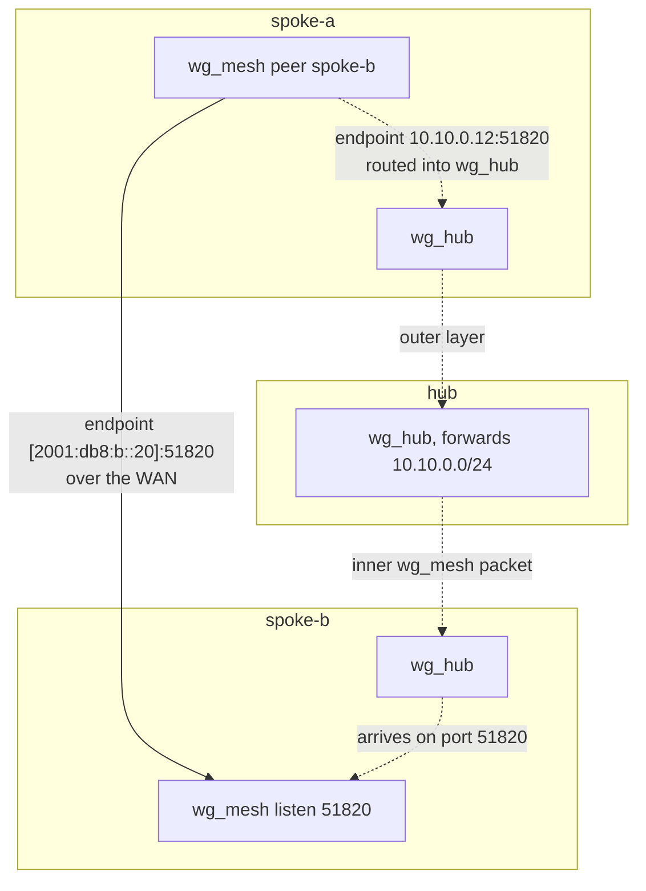

# About wgpathd

wgpathd exists to answer one question for every pair of sites, all the time: can these two talk directly, or must they go through the hub? It answers by trying, and it only ever acts by moving a WireGuard peer endpoint.

---

## Direct and relay

In a plain hub-and-spoke WireGuard setup, spoke-a reaches spoke-b through the hub. That always works, because every spoke keeps a tunnel to the hub. But it costs a detour: every byte between two sites crosses the hub, adds latency, and uses the hub's bandwidth.

When at least one of the two sites is reachable on public IPv6, the detour is unnecessary. The two spokes can hold a WireGuard session straight to each other. wgpathd calls this the **direct** path, and the detour the **relay** path. Direct is the optimization. Relay is the floor that always works.

The trick is that both paths use the **same** WireGuard interface and the **same** session. `wg_mesh` on spoke-a has one peer for spoke-b. What changes is only that peer's endpoint:

- **Direct:** the endpoint is spoke-b's public IPv6 address, for example `[2001:db8:b::20]:51820`. Packets go out over the WAN.
- **Relay:** the endpoint is spoke-b's address on the hub tunnel, for example `10.10.0.12:51820`. That address routes into `wg_hub`, so the already-encrypted `wg_mesh` packet travels inside the hub tunnel. The hub decrypts the outer layer and forwards the inner packet to spoke-b over spoke-b's own `wg_hub` tunnel. The hub never sees the site traffic in clear text.

Since the tunnel does not change, switching paths never changes addressing, AllowedIPs or routes. The kernel keeps routing site traffic into `wg_mesh`; wgpathd just decides which underlay carries it.

## Data plane and control plane

The name hub-and-spoke can mislead. In a working wgpathd setup the **data plane** is spoke-to-spoke whenever direct works. Only the **control plane** is hub-and-spoke: the hub tells spokes where the others currently are ([discovery](discovery.md)), and it serves as the relay when direct does not work.

The two roles follow from this:

- A **spoke** runs the path decision. For each mesh peer it gathers evidence, tries the direct path, proves it, and keeps checking it. See [About the path state machine](state-machine.md).
- The **hub** makes no decisions. It reads its own `wg_mesh` peer table and publishes the IPv6 endpoints it sees over a small HTTP endpoint.

Each spoke decides only where **it** sends. spoke-a to spoke-b and spoke-b to spoke-a are separate decisions. For a short while one side may be direct and the other relayed. That is legal and both directions still work; there is no consensus protocol to get wrong.

## What it deliberately does not do

wgpathd is small because it refuses most of the job that tools like Tailscale or Netmaker take on.

- **It does not create or change interfaces.** It never writes `/etc/config`, never touches AllowedIPs, routes, MTU or `wg_hub`. It checks that the interfaces it was told about exist and refuses to start otherwise. The reason is safety: the worst a wgpathd bug can do is point a mesh peer at a bad endpoint. It can never cut the hub tunnel you use to manage the router. See the [trust model](trust-model.md).
- **It does not distribute keys or peers.** Which peers exist, and their keys and AllowedIPs, are static configuration you render yourself. The hub publishes only endpoints.
- **It does not do NAT traversal.** There is no STUN, no hole punching, no relay protocol of its own. wgpathd assumes at least one side of a pair accepts inbound IPv6. If neither does, the pair stays on the relay, which is the correct result.
- **It does not push metrics.** Per-peer state and switch counts are in the [`ubus call wgpathd status`](../reference/ubus-status.md) reply for whatever collector you already run.

If you have many sites and several pairs where neither side is reachable, a full NAT-traversal product is the better tool. For a handful of sites with at least one reachable IPv6 anchor, wgpathd is one ucode process that is readable in an afternoon.

## Further reading

The [design record](../design.md) has the original requirements, the prior-art comparison and the failure-mode catalog.
