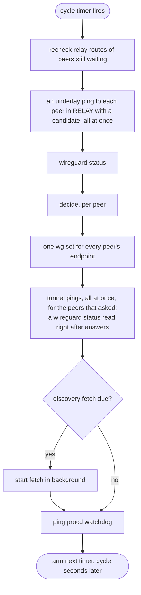

# Architecture

wgpathd is built as a **functional core with an imperative shell**. One pure function makes every path decision. Everything that touches the system — ubus, commands, HTTP, sockets, routes, files, the clock — lives in a thin shell around it. This page explains that split and how one cycle runs.

---

## The pure core

The core is `decide(ctl, obs, params, now)` in `decide.uc`. For one peer, it takes:

- `ctl`, the peer's control state: its RELAY/TRIALING/DIRECT state, streak counters, backoff, trial deadline, target, and the endpoint wgpathd last set;
- `obs`, what the shell observed this cycle: the kernel's current endpoint, the underlay probe result, last cycle's tunnel probe result and the endpoint the kernel held right after its answer, the discovery candidate, the relay endpoint and the tunnel address;
- `params`, the timing parameters and the mode;
- `now`, the time, passed in rather than read.

It returns the next `ctl` and a list of **effects**. It does no I/O and reads no clock, so a test can replay any scenario, including the passage of minutes, instantly and exactly.

The effects form a closed vocabulary: `set_endpoint`, `tunnel_probe`, `refresh_discovery`, `log` and `metric`. `effects.uc` defines and validates it. There is no effect that could create an interface or change AllowedIPs, which is how the [scope limit](trust-model.md#endpoints-only) is enforced by structure.

## The shell

The shell (`daemon.uc`) gathers observations, calls `decide` for each peer, and carries out the effects. It holds no decisions of its own. All its I/O comes through a single `deps` object built in `deps.uc`, which is what lets the integration tests replace every system interface with a fake.

The I/O each part uses:

| Need | Mechanism |
| :--- | :--- |
| Read WireGuard peer state | `ubus call wireguard status` (from `rpcd-mod-wireguard`), asynchronous |
| Set the endpoints | one `wg set <iface> peer <key> endpoint <addr> ...` per cycle, exit code only |
| Underlay and tunnel probes | ICMP echo on raw sockets via `ucode-mod-socket`, on the uloop |
| Relay route check, mesh MTU | rtnl `RTM_GETROUTE` and `RTM_GETLINK` via `ucode-mod-rtnl` |
| Discovery fetch (spoke) | asynchronous HTTP GET via `ucode-mod-uclient` |
| Discovery server (hub) | TCP listener via `ucode-mod-socket` on the uloop |
| Status | a `wgpathd` ubus object with a `status` method |
| Liveness | procd watchdog ping, `ubus call service watchdog` |
| Configuration | UCI, read at startup and on `SIGHUP` |

The one command, `wg set`, runs through `uloop.process` with its output discarded, under a timer backstop, because a child process cannot be killed from ucode, only forgotten. A spoke therefore starts one process per cycle, however many peers it steers.

The probes are sent by the daemon itself. It keeps a raw socket per address family and device, registered on the loop, and matches each echo reply to its probe by source address, echo id and sequence number: the id is the daemon's own and every probe takes a new sequence number, so a late reply to an earlier probe, or a reply to someone else's ping, never counts. Anything else the socket receives is dropped.

Everything runs on one single-threaded uloop. Nothing blocks: the ubus read, the probes, `wg set` and the HTTP fetch are all callbacks.

## One spoke cycle

Some details that matter operationally:

- **The kernel is read last, just before deciding.** Every cycle re-asserts every endpoint, and a peer's direct packet may roam the kernel while the underlay pings wait. Reading `wireguard status` after them, rather than alongside, lets `decide` see such a roam before the re-assert overwrites it.
- **A tunnel probe answer belongs to the next cycle.** The pings are sent right after `wg set` returns, and their results are stored for the next cycle's `obs`. If `wg set` fails, no probe is sent at all, since the command may have set some endpoints and not others, so a probe over the old path can never commit a trial.
- **An answer is read together with the path it came back on.** The answer, like every authenticated packet, moves the kernel endpoint to where it came from, so the shell reads `wireguard status` right after it and stores that endpoint with the result. `decide` commits a trial only on an answer that came back from its target (see [the state machine](state-machine.md#relay-traffic-and-the-proof)). Answers that arrive while such a read is in flight share the next read, which starts as soon as it returns; a read made before an answer arrived could show the endpoint from before that answer moved it, so it never serves one.
- **A cycle only waits for gathering and applying.** The timer for the next cycle is armed `cycle` seconds after the current one finishes. With probes and `wg set` taking up to their timeouts, the real period is a little longer than `cycle`.
- **The watchdog ping is the last step.** procd restarts the daemon if it has not been pinged for 30 seconds. A stuck cycle stops pinging, so a hang becomes a restart, and a restart puts every peer back on the relay.
- **An unreadable `wireguard status` skips deciding for that cycle.** Peers keep their state and no endpoint is set. Any pending tunnel probe result is discarded, so a DIRECT peer counts a failed probe on the next cycle.

The hub's cycle is shorter: read the `wireguard status` of `read_iface`, replace the snapshot if the read worked, ping the watchdog, arm the timer. The HTTP server answers from the latest snapshot and never runs a command per request.

## Startup

The init script runs `check.uc --config` before it asks procd for an instance. The check uses the daemon's own configuration loader, so it cannot disagree with the daemon. procd respawns a daemon that exits, which is what turns a hang or a crash into a clean start on the relay; but a configuration the daemon can never load would only exit again every 5 seconds. Checking first keeps that case out of the respawn loop: the service is left without an instance and the reason is on the console and in the log.

The daemon's own startup is fail-closed:

1. Load and validate `/etc/config/wgpathd` and, on a spoke, the annotated `wg_mesh` peers from `/etc/config/network`.
2. Check the WireGuard interface (`mesh_iface` or `read_iface`) is present in the `wireguard status` reply, so it exists in the kernel, not only in UCI.
3. On a spoke, run the relay loop guard for each peer, log every unmanaged peer, and load the discovery cache.
4. Publish the `wgpathd` ubus object; on the hub, also bind the discovery listener.
5. Log `started role=<role> ...` and run the first cycle.

Any failure in steps 1, 2 or 4 exits with status 1 and a logged reason. procd then respawns the service after 5 seconds. These are the failures the config check cannot see, such as an interface that is not up yet, so retrying them is useful. See [log messages](../reference/log-messages.md).

## Reload

A restart is always safe, because every peer falls back to the relay, but it throws away evidence: a peer that was DIRECT has to earn direct again. So a configuration change is applied with `SIGHUP` instead. procd sends `reload` when the `wgpathd` or `network` configuration changes, and the init script turns it into a signal, again only after the config check passes.

On the signal the daemon loads the configuration again, with a fresh UCI cursor, and sorts the changes into two kinds:

- **Structural.** `role`, the interfaces and the listener address and port decide what the process is: which ubus reads it makes, which socket it holds, whether it steers or publishes. Rewiring those in place would be a second startup path, so the daemon exits instead and lets procd start it afresh 5 seconds later.
- **Everything else** is data the cycle reads each time: the timing parameters, the mode and the discovery URL simply take effect on the next cycle.

Peers are matched by public key, relay endpoint and tunnel address. A peer whose three values are unchanged keeps its control state, because its evidence and backoff were earned on exactly that path. A new peer, or one whose relay or tunnel changed, starts in RELAY like at startup, after the relay loop guard. A removed peer is dropped from steering and status.

If the configuration is invalid by the time the daemon reads it, the daemon logs it and keeps the configuration it has. A signal that arrives before startup completes is applied right after it.

## Module map

| Module | Role |
| :--- | :--- |
| `decide.uc`, `state.uc`, `effects.uc` | The pure core: decision, state helpers, effect vocabulary |
| `daemon.uc` | The shell: startup, reload, cycles, status, hub snapshot |
| `relay.uc` | The relay loop guard, shared by the daemon and the check |
| `check.uc`, `status_view.uc` | `service wgpathd check` and the text of `service wgpathd status` |
| `rpc.uc`, `candidate.uc` | The `wgpathd.config` ubus object that rpcd serves, and unsaved values laid over the saved configuration |
| `publisher.uc` | Hub snapshot and the HTTP request/response mapping and listener |
| `discovery.uc` | Spoke payload validation and the cache |
| `config.uc`, `params.uc` | Configuration loading and timing defaults |
| `wg.uc`, `endpoint.uc` | The `wireguard status` parser, the `wg set` command, the endpoint canonical form |
| `probe.uc`, `icmp.uc` | What each probe is (host, size, device), and ICMP echo on the wire |
| `deps.uc`, `components/` | Real I/O: ubus, syslog, rtnl, uclient HTTP, command runner, ICMP prober, clock |
| `result.uc`, `errors.uc` | The ok/err result type and the [error codes](../reference/error-codes.md) |

Endpoints are compared as plain strings, so every endpoint that enters the core — from the kernel, discovery, the cache or the annotations — is first put in one canonical form (`[v6]:port` or `v4:port`, lowercase and compressed, as `wg` prints it). Without that, the same address written two ways would look like a roam every cycle.

## Further reading

The [design record](../design.md) sections "The decision-core seam" and "Shell details" hold the full contract, including the property invariants the test suite checks.
