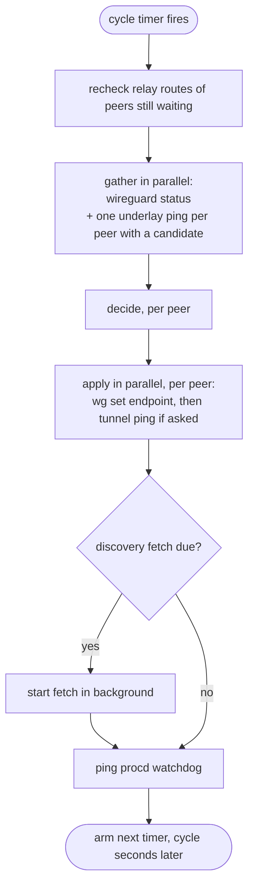

# Architecture

wgpathd is built as a **functional core with an imperative shell**. One pure function makes every path decision. Everything that touches the system — ubus, commands, HTTP, sockets, routes, files, the clock — lives in a thin shell around it. This page explains that split and how one cycle runs.

---

## The pure core

The core is `decide(ctl, obs, params, now)` in `decide.uc`. For one peer, it takes:

- `ctl`, the peer's control state: its RELAY/TRIALING/DIRECT state, streak counters, backoff, trial deadline, target, and the endpoint wgpathd last set;
- `obs`, what the shell observed this cycle: the kernel's current endpoint, the underlay probe result, last cycle's tunnel probe result, the discovery candidate, the relay endpoint and the tunnel address;
- `params`, the timing parameters and the mode;
- `now`, the time, passed in rather than read.

It returns the next `ctl` and a list of **effects**. It does no I/O and reads no clock, so a test can replay any scenario, including the passage of minutes, instantly and exactly.

The effects form a closed vocabulary: `set_endpoint`, `tunnel_probe`, `refresh_discovery`, `log` and `metric`. `effects.uc` defines and validates it. There is no effect that could create an interface or change AllowedIPs, which is how the [scope limit](trust-model.md#endpoints-only) is enforced by structure.

## The shell

The shell (`daemon.uc`) gathers observations, calls `decide` for each peer, and carries out the effects. It holds no decisions of its own. All its I/O comes through a single `deps` object built in `deps.uc`, which is what lets the integration tests replace every system interface with a fake.

The I/O each part uses:

| Need | Mechanism |
| :--- | :--- |
| Read WireGuard peer state | `ubus call wireguard status` (from `rpcd-mod-wireguard`), asynchronous |
| Set an endpoint | `wg set <iface> peer <key> endpoint <addr>`, exit code only |
| Underlay and tunnel probes | busybox `ping`, exit code only |
| Relay route check | rtnl `RTM_GETROUTE` via `ucode-mod-rtnl` |
| Discovery fetch (spoke) | asynchronous HTTP GET via `ucode-mod-uclient` |
| Discovery server (hub) | TCP listener via `ucode-mod-socket` on the uloop |
| Status | a `wgpathd` ubus object with a `status` method |
| Liveness | procd watchdog ping, `ubus call service watchdog` |
| Configuration | UCI, read once at startup |

Commands run through `uloop.process` with their output discarded. Nothing in the daemon parses command output. Each command has a timer backstop, because a child process cannot be killed from ucode, only forgotten.

Everything runs on one single-threaded uloop. Nothing blocks: the ubus read, the probes, `wg set` and the HTTP fetch are all callbacks.

## One spoke cycle

Some details that matter operationally:

- **A tunnel probe answer belongs to the next cycle.** The ping is sent right after `wg set` returns, and its result is stored for the next cycle's `obs`. If `wg set` fails, no probe is sent, so a probe over the old path can never commit a trial.
- **A cycle only waits for gathering and applying.** The timer for the next cycle is armed `cycle` seconds after the current one finishes. With probes and `wg set` taking up to their timeouts, the real period is a little longer than `cycle`.
- **The watchdog ping is the last step.** procd restarts the daemon if it has not been pinged for 30 seconds. A stuck cycle stops pinging, so a hang becomes a restart, and a restart puts every peer back on the relay.
- **An unreadable `wireguard status` skips deciding for that cycle.** Peers keep their state and no endpoint is set. Any pending tunnel probe result is discarded, so a DIRECT peer counts a failed probe on the next cycle.

The hub's cycle is shorter: read the `wireguard status` of `read_iface`, replace the snapshot if the read worked, ping the watchdog, arm the timer. The HTTP server answers from the latest snapshot and never runs a command per request.

## Startup

Startup is fail-closed:

1. Load and validate `/etc/config/wgpathd` and, on a spoke, the annotated `wg_mesh` peers from `/etc/config/network`.
2. Check the WireGuard interface (`mesh_iface` or `read_iface`) is present in the `wireguard status` reply, so it exists in the kernel, not only in UCI.
3. On a spoke, run the relay loop guard for each peer, log every unmanaged peer, and load the discovery cache.
4. Publish the `wgpathd` ubus object; on the hub, also bind the discovery listener.
5. Log `started as <role>` and run the first cycle.

Any failure in steps 1, 2 or 4 exits with status 1 and a logged reason. procd then respawns the service after 5 seconds. See [log messages](../reference/log-messages.md).

## Module map

| Module | Role |
| :--- | :--- |
| `decide.uc`, `state.uc`, `effects.uc` | The pure core: decision, state helpers, effect vocabulary |
| `daemon.uc` | The shell: startup, cycles, status, hub snapshot |
| `publisher.uc` | Hub snapshot and the HTTP request/response mapping and listener |
| `discovery.uc` | Spoke payload validation and the cache |
| `config.uc`, `params.uc` | Configuration loading and timing defaults |
| `wg.uc`, `probe.uc`, `endpoint.uc` | Parsers and command builders: `wireguard status`, `wg set`, `ping`, endpoint canonical form |
| `deps.uc`, `components/` | Real I/O: ubus, syslog, rtnl, uclient HTTP, command runner, clock |
| `result.uc`, `errors.uc` | The ok/err result type and the [error codes](../reference/error-codes.md) |

Endpoints are compared as plain strings, so every endpoint that enters the core — from the kernel, discovery, the cache or the annotations — is first put in one canonical form (`[v6]:port` or `v4:port`, lowercase and compressed, as `wg` prints it). Without that, the same address written two ways would look like a roam every cycle.

## Further reading

The [design record](../design.md) sections "The decision-core seam" and "Shell details" hold the full contract, including the property invariants the test suite checks.
