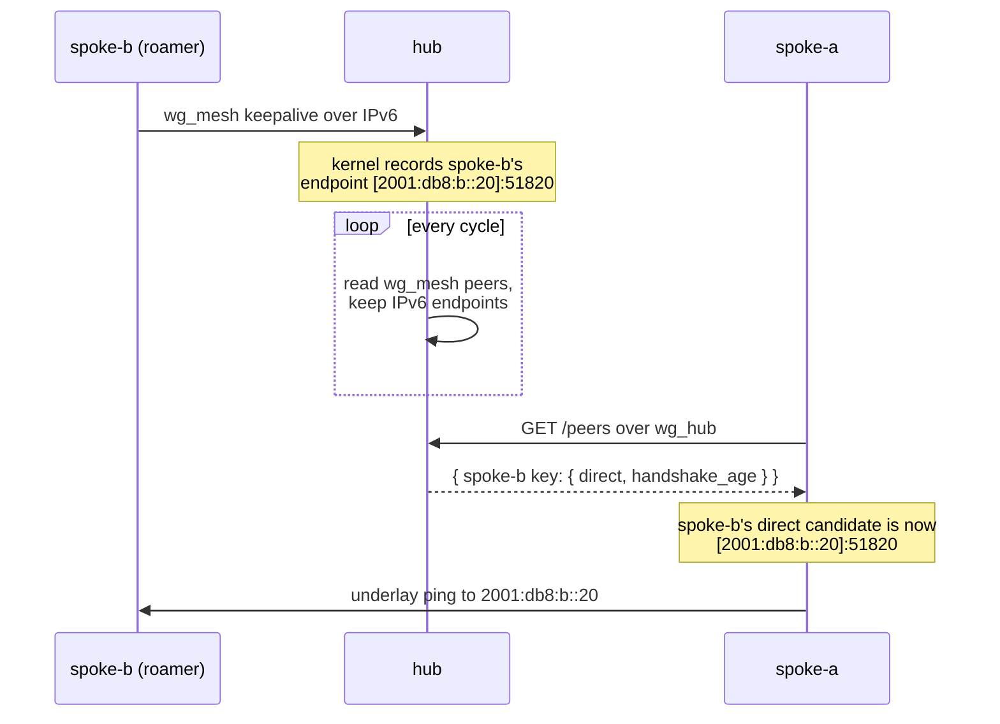

# About Discovery

A spoke cannot try a direct path to a peer without knowing the peer's public IPv6 address. Roaming sites change that address. Discovery is how spokes learn it: the hub publishes the endpoints it sees, and spokes fetch them.

---

## Why the hub knows

Every spoke has the hub as a `wg_mesh` peer with a fixed endpoint and a persistent keepalive. The keepalive means each spoke sends the hub a packet over IPv6 at least every 25 seconds or so. WireGuard on the hub records the source address of each valid packet as that peer's endpoint. So the hub's own `wg_mesh` peer table always holds each spoke's current public IPv6 address and port, with no extra protocol.

The hub side of wgpathd simply reads that table once per cycle and keeps a snapshot of the peers whose endpoint is IPv6. It publishes the snapshot as JSON on `GET /peers`. It keeps no other state.

The hub reads `wg_mesh` but serves on its `wg_hub` address. That split matters. `wg_mesh` is where the IPv6 endpoints live, so it is the only table worth reading. `wg_hub` is the tunnel that stays up when the mesh is broken, so serving there means discovery works exactly when it is needed.

## Soft state, never in the way

Discovery supplies **where** to probe. The probes and the trial decide **whether** the path works. Nothing the hub says can commit a peer to DIRECT on its own.

Because of that, discovery is allowed to be stale or missing:

- A spoke fetches on its first cycle and then every `discovery_interval` (60 seconds by default). When a peer sits in RELAY with no evidence, the spoke asks for an early refresh, at most every 10 seconds. That is how a spoke picks up a peer that moved while the direct path was down.
- The fetch runs in the background. The cycle never waits for it, so a dead hub never slows a fallback to relay.
- A good payload replaces the known map and is saved to `/var/run/wgpathd/cache.json`. A failed fetch keeps the last map. On startup the spoke loads the cache, so it can probe before the first fetch succeeds.
- The cache is on tmpfs. It survives a daemon restart but not a reboot. That is fine: the relay endpoint never comes from discovery, so an empty cache only means a spoke stays on the relay until the hub answers.

## Strict about what it accepts

The spoke treats the payload as untrusted input. One bad entry rejects the whole payload, which then counts as a failed fetch. The limits are listed in the [discovery HTTP API reference](../reference/discovery-api.md). Rejecting everything rather than filtering keeps a buggy or hostile hub to one effect: spokes stop learning new addresses. See the [trust model](trust-model.md) for why that is the worst it can do.

Entries for keys the spoke does not manage are ignored. The hub publishes every peer it sees, including the spoke itself; each spoke looks up only the `wg_mesh` public keys of its own annotated peers.

## Only the roamer really needs it

A spoke with a stable public address could, in principle, be configured statically. wgpathd does not bother. Discovery publishes every IPv6 peer, stable or not, so all spokes can share one identical wgpathd configuration. The per-peer facts that must not come from the hub, the relay address and the tunnel address, live in the static network configuration next to each peer's key.

## Further reading

- [Discovery HTTP API](../reference/discovery-api.md) for the exact request, response and limits.
- The [design record](../design.md), sections "Discovery" and "Discovery contract", for the history of this contract.
