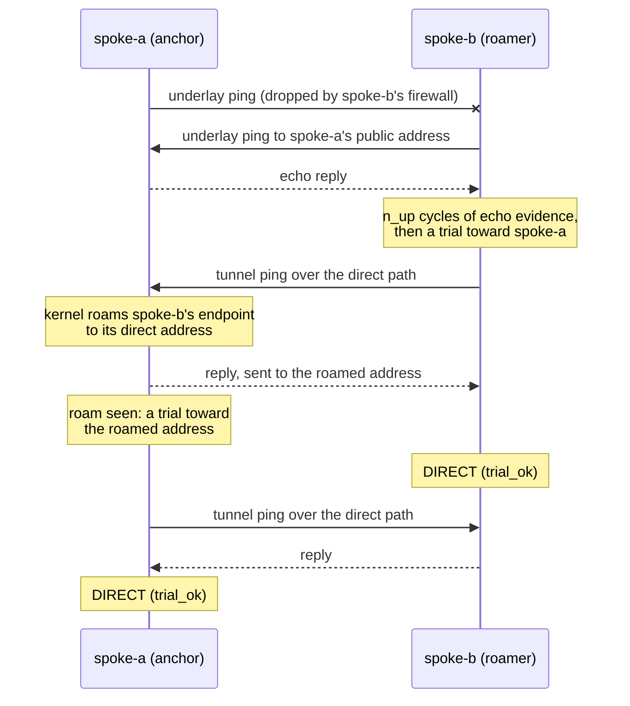

# About the Path State Machine

On a spoke, every managed mesh peer has its own small state machine. It has three states: **RELAY**, **TRIALING** and **DIRECT**. This page explains why it has those states, what moves a peer between them, and why the rules are lopsided on purpose.

---

## The shape

```mermaid
stateDiagram-v2
    [*] --> RELAY: start
    RELAY --> RELAY: re-assert relay endpoint,<br/>count evidence
    RELAY --> TRIALING: n_up cycles of evidence<br/>toward an address not given up,<br/>or a roam; backoff expired<br/>(trial_start)
    TRIALING --> TRIALING: set target, probe again
    TRIALING --> DIRECT: tunnel probe answered<br/>over the direct path<br/>(trial_ok)
    TRIALING --> RELAY: trial_window passed<br/>(trial_timeout, backoff grows,<br/>the failure counts)
    DIRECT --> DIRECT: re-assert target, probe,<br/>adopt roams
    DIRECT --> RELAY: m_down failed probes<br/>(demoted, backoff grows)
    TRIALING --> RELAY: mode set to observe<br/>(observe_mode)
    DIRECT --> RELAY: mode set to observe<br/>(observe_mode)
```

Every peer starts in RELAY, including after a restart. State is kept in memory only, so a restarted daemon earns direct again from scratch. That takes a few seconds and keeps the design simple. A configuration reload is gentler: it keeps the state of every peer whose settings did not change (see [Architecture](architecture.md#reload)).

Once per cycle (every 3 seconds by default), wgpathd sets the endpoint the current state calls for: the relay endpoint in RELAY, the direct target in TRIALING and DIRECT. It does this every cycle even if nothing changed. `wg set ... endpoint` does not rekey or interrupt the session, so re-asserting is harmless.

## Evidence first, then proof

A direct path needs two different kinds of support before wgpathd commits to it.

**Evidence** is cheap and gathered every cycle. There are two kinds:

- **Underlay echo.** wgpathd pings the peer's public IPv6 address (the candidate learned from [discovery](discovery.md)) outside the tunnel. A reply means the peer's host is reachable on IPv6. Only a peer in RELAY is pinged: that is the only state in which the echo decides anything.
- **Authenticated roam.** WireGuard moves a peer's endpoint to the source address of the last valid packet from that peer. If the kernel shows an endpoint that is neither what wgpathd set nor the relay, the peer has just reached us directly, and it did so with a packet that passed its static key. Nobody can fake that without the key.

A peer needs `n_up` consecutive cycles of evidence (5 by default, about 15 seconds) before a trial may start. A roam is the exception: one is enough, for reasons explained [below](#why-the-anchor-needs-roams).

Evidence is not proof. A host can answer ICMP while its firewall drops UDP to the WireGuard port. So the next step is a **trial**: wgpathd sets the endpoint to the direct target and immediately sends a ping to the peer's tunnel address, through `wg_mesh`. Only an answer to that ping, coming back over the direct path, commits the peer to DIRECT. It proves the whole path works, in both directions, for real WireGuard traffic.

Why a round trip, and not "wait for a new handshake"? Because changing an endpoint does not start a handshake. The session keys stay the same, and the kernel only rekeys every two minutes or after sends go unanswered. A trial that waited for a handshake would fail on good paths and bad paths alike. So wgpathd never uses handshake age to decide anything; it is shown in the hub's discovery data for diagnosis only.

In DIRECT, the same tunnel ping runs every cycle. It is the health check, and it also keeps the session and any stateful firewall on the path warm.

The tunnel ping is as large as `wg_mesh` allows: the whole packet fills the interface's MTU, and it is never fragmented on the way out. A direct path that carries small packets but loses large ones, such as a link with a smaller MTU that drops them instead of reporting it, would pass a small ping while real traffic stalls. With a full-size ping such a path fails its trial or its health check, and the peer stays on, or returns to, the relay. The ping is also bound to `wg_mesh`, so whatever the routes say, it can only leave through the tunnel.

## Relay traffic and the proof

WireGuard roams on every authenticated packet, and that includes packets that come through the relay. Suppose spoke-b trials while spoke-a is still in RELAY and its site is sending traffic. wgpathd on spoke-b sets the direct endpoint, and a moment later a packet from spoke-a arrives through the hub and moves spoke-b's endpoint straight back to the relay. The trial ping then leaves through the relay, spoke-a answers it through the relay, and the answer says nothing about the direct path. Counting it would commit DIRECT on a path that may be dead, and on a dead path the daemon would then re-assert the dead endpoint every cycle and never back off.

So a trial's answer only counts if it came back from the trial's target. The answer is itself an authenticated packet: it moves the kernel endpoint to wherever it came from. wgpathd reads the endpoint right after the answer arrives. If that is not the target, the relay included, the trial carries on, setting the target and probing again each cycle, and times out with a backoff if no answer comes back from the target before the deadline. Requiring the target and not merely some direct address matters because the trial is about to commit to it: an answer from elsewhere proves a path, not the one DIRECT would then assert. If the peer moves to a new direct address in the middle of a trial, the trial therefore times out, and the next one, after the backoff, can start on the new address.

DIRECT does not apply this rule: any answer keeps the peer DIRECT, whichever path the read shows. While the other side is still in RELAY and sending, as it is during a trial of its own, in observe mode or in backoff, its relayed packets move our endpoint back onto the relay within a millisecond of nearly every direct answer, and more so the slower the relay is than the direct path. Measured in the lab with steady traffic from a side held in RELAY, applying the rule in DIRECT demoted a healthy direct path again and again, whatever the relay delay, and with 20 ms of added relay delay the two sides mostly never converged. The price of the looser rule: a path that dies while DIRECT, with the other side sending through the relay, can keep answering over the relay and stay DIRECT. Traffic still flows, since every relayed packet moves the endpoint back onto the relay, but the state is wrong; `relayed_answers` in the [status](../reference/ubus-status.md) keeps growing while that lasts. A roam to another direct address is followed in the next cycle.

The endpoint is read right after the answer, not at the start of the next cycle, on purpose. A peer in RELAY re-asserts its relay endpoint every cycle. If it has traffic to send, its next packet comes through the relay and moves our endpoint back there, well before our next cycle begins. A check made then would reject every answer while the other side is in RELAY, even on a healthy path, and two sides whose backoffs run out at different times could each wait for the other forever.

A trial is still at the mercy of timing under heavy traffic from the other side: if a relayed packet lands between `wg set` and the ping, the ping itself goes through the relay. The trial then simply tries again on its next cycle.

## What a trial costs

A trial is not free. A WireGuard peer has one endpoint, so while a trial runs, all traffic to that peer takes the candidate path. On a good path the probe answers on the next cycle and nothing is lost. On a bad one, that peer's traffic is lost until the trial window ends, up to `trial_window` (8 seconds by default), and then it returns to the relay.

There is no cheaper test. WireGuard ignores unauthenticated packets, so nothing outside the tunnel can prove a path works, and one peer cannot use two endpoints at once.

The cost repeats when the evidence is misleading: a peer that answers ICMPv6 echo while a firewall blocks UDP to its WireGuard port, or an address that is stale or wrong but still answers ping. The echo keeps producing evidence, so each backoff expiry would start another trial and lose another window: with the backoff at its cap of 15 minutes, about 1% of that peer's traffic, for as long as the address stays. [Giving up an address](#giving-up-an-address) bounds that. A failed trial keeps the peer on its target until the first cycle at or after `trial_window`: 9 seconds with the defaults. The worst cases, with the defaults, over a day:

| Case | What it costs |
| :--- | :--- |
| A fixed address that answers ping but never carries WireGuard | `give_up_after` trials within the first few minutes, then one each time `give_up_pause` runs out: 6 trials, 54 seconds, in the first day (0.06%). Without giving up it was about 99 trials, 15 minutes (1%). |
| A hub that publishes another bad address on every fetch | Every address is new, so none is given up, and the backoff alone bounds it: one trial per backoff, `backoff_max` once it has grown, about 1% as before. A hub can already hold its spokes on the relay by publishing nothing, so a lying hub gains nothing new. |
| A good address after a long outage that let ping through but not WireGuard | The address was given up during the outage. Once the path is back, the peer stays on the relay until its pause runs out, at most `give_up_pause` (6 hours), unless the other side's packets arrive directly first, the hub publishes another address, or the daemon restarts. The cost is time on the relay; no traffic is lost. |

An outage that stops ping as well costs nothing of the kind: without evidence no trial runs and nothing is counted, so the first trial after the path is back commits.

## Giving up an address

After `give_up_after` trials in a row on the same address time out (3 by default), wgpathd gives that address up. It logs `direct address given up`, and the peer's [status](../reference/ubus-status.md) shows it under `given_up`. From then on:

- The underlay echo alone starts no trial toward that address. The peer stays on the relay.
- A trial starts again, backoff permitting, only when something changes. wgpathd logs `direct address trials resumed` with the reason:
    - `roam`: the peer's own packets arrive directly, an authenticated roam. As always, the trial starts at once and takes the roam's source as its target.
    - `new_candidate`: discovery offers another address for the peer, and it answers the echo. A different port makes a different address.
    - `pause_over`: `give_up_pause` (6 hours by default) has passed since the address was given up. The echo may start one more trial toward it.
- If the trial toward the same address fails again, after the pause or after a roam from that address, the address is given up again at once, without `give_up_after` more failures, and the pause starts over.

Only a trial that times out counts, against its target: the endpoint with its port. A timeout on another target starts the count again at one: wgpathd keeps a count for one address per peer at a time, so once another address has been tried, the one given up before gets `give_up_after` trials again. A trial that commits clears the count.

A demotion from DIRECT is not counted. A path that passed its trial carried the peer's packets both ways, so the address is right; what failed is the path, for a while, and a failing path is what the backoff is for. Even a path that passes every trial and dies right after costs no more than before: `m_down` failed probes per backoff, the backoff growing to its cap. Counting those demotions would give a correct address up and keep the peer on the relay for the whole pause.

The underlay probe keeps running while an address is given up. It is one small ping per cycle, it shows in the status whether the address still answers, and the evidence it keeps counting lets the trial after the pause start at once.

Giving up applies whether discovery is fresh or not. Candidates never expire, and the cache keeps them through a hub outage on purpose: a remembered address that is still right lets two spokes find each other while the hub is down. Giving up bounds what a remembered address that has gone wrong can cost.

Observe mode never trials, so it never counts a failure. A peer whose address is given up is not `ready`, since steer mode would not trial it. The count and the give-up are kept in memory with the rest of the peer's state: a reload keeps them for every peer whose settings did not change, and a restart of the daemon forgets them, which is the way to retry at once.

Two spokes can give each other's address up, as when a firewall filters the path in both directions. When one of them retries at the end of its pause and the path works again, its trial's packets reach the other directly, a roam, so the other trials at once and both return to DIRECT together.

## Why the anchor needs roams

Picture the common case. spoke-a is the **anchor**: it accepts inbound IPv6. spoke-b is a **roamer** behind a stateful firewall that drops unsolicited traffic.

- spoke-b pings spoke-a's public address. spoke-a answers. spoke-b has evidence, trials, and goes DIRECT.
- spoke-a pings spoke-b's public address. spoke-b's firewall drops it. spoke-a never gets echo evidence.

If echo were the only evidence, spoke-a would stay on the relay forever. It does not, because spoke-b's trial and health pings arrive at spoke-a directly. Each one roams spoke-a's kernel endpoint to spoke-b's direct address. spoke-a reads that roam as evidence and trials toward the roamed address at once, without waiting for `n_up` cycles, and goes DIRECT too.

One roam is enough because it is authenticated proof that spoke-b is sending to spoke-a directly right now, and because waiting would defeat spoke-b. Until spoke-a trials, it re-asserts the relay every cycle, and its site's traffic then reaches spoke-b through the relay and pulls spoke-b's endpoint back onto it. Under steady traffic, spoke-b's pings reach spoke-a directly only now and then. A streak of `n_up` roams could take far longer than spoke-b's trial window. The trial still has to pass, and the backoff still applies.

This is also why wgpathd reads roams before it re-asserts. A daemon that blindly overwrote the endpoint every cycle would fight WireGuard's per-packet roaming instead of learning from it.

In DIRECT, a roam to a new direct address is adopted as the new target, logged as a `roam` event. This is how a spoke follows a peer that changes address while direct is healthy, with no dip to the relay. A roam to the relay address is not adopted: it only means the other side is relaying for now. If the probe's answer came back through the relay as well, it counts as a failed probe (see [Relay traffic and the proof](#relay-traffic-and-the-proof)).

## Fast down, slow up

The rules are asymmetric on purpose.

- **Falling back is fast.** In DIRECT, `m_down` failed tunnel probes in a row (2 by default) demote the peer to RELAY. Each probe's answer is read on the next cycle, and on a dead path every cycle also waits for its probes to time out, so with the defaults a dead path is left in roughly 8 to 15 seconds. A probe that did not complete in time counts as failed, and so does one answered through the relay. The relay is the safe place to be when in doubt.
- **Coming back is slow.** A return to direct needs `n_up` cycles of evidence (or a roam from a peer that is already trialing or DIRECT) **and** a successful trial, **and** the backoff must have expired. The echo alone starts no trial toward an address that has been [given up](#giving-up-an-address).

The backoff is what stops a flapping path from bouncing. Each failed trial and each demotion bumps it: the first time to `backoff_min` (30 seconds), then doubling each time up to `backoff_max` (15 minutes). It resets only after DIRECT has held for `backoff_reset` (10 minutes). A path that works for a minute and then breaks walks its backoff up to the cap and ends up parked on the relay, which is the outcome you want from a bad path. Evidence keeps counting during the backoff, so a peer that is ready trials as soon as the backoff ends.

A quiet link is never demoted for being quiet. DIRECT is judged only by the tunnel probe, which wgpathd sends itself, never by traffic or handshake age.

## Corner cases

A few rules settle what the diagram leaves open:

- **The first cycle judges no roam.** wgpathd has set nothing yet, so whatever endpoint the kernel holds is not a roam. The first cycle sets the relay.
- **The deadline comes first.** An answer that arrives in the cycle at or after `trial_window` is a timeout, not a commit.
- **A demotion beats a roam.** If a DIRECT peer reaches `m_down` failed probes in the same cycle a roam shows up, it is demoted; the roam can start a trial once the backoff allows.
- **Every transition starts the streaks over.** Evidence counts only in RELAY, and a new trial needs a fresh `n_up` streak, which may build up while the backoff runs.

## Observe and steer

A spoke runs in one of two modes.

In **steer** mode the state machine runs as described.

In **observe** mode a peer never leaves RELAY and no tunnel probes are sent. Evidence is still gathered and counted, and the status reports `ready: true`, and the log `ready, steer would trial`, when a peer has enough evidence that steer mode would start a trial. This lets you watch what wgpathd would do on a live network before you let it move traffic. Observe is the default, and any unknown mode value is treated as observe.

Observe mode is not hands-off. A managed peer is still set to its relay endpoint every cycle. The whole point of observe is that every managed peer sits on the known-good floor while you watch. Switching a DIRECT peer back to observe demotes it to RELAY, without a backoff, with the reason `observe_mode`.

## When things fail

The rules above were worked out against the ways a mesh breaks. What a spoke does in each, with the default parameters:

| What fails | What wgpathd does |
| :--- | :--- |
| The hub's discovery server stops, the hub is otherwise up | Spokes keep the addresses they last fetched. DIRECT peers stay DIRECT, and the relay still works. |
| The whole hub goes down | Direct sessions are peer to peer and keep working. A peer that changes address is still followed through its [authenticated roam](#why-the-anchor-needs-roams). Pairs that were on the relay lose connectivity until the hub is back. |
| `wg_hub` goes down, the direct path is healthy | Direct paths are unaffected; spokes run on their cached addresses. |
| The hub publishes a wrong address | The trial gets no answer, the peer returns to the relay with a backoff, and the address is [given up](#giving-up-an-address) after `give_up_after` failures. See the [trust model](trust-model.md). |
| The hub sends a malformed peer list | The whole payload is rejected and the last good addresses are kept. See [discovery](discovery.md#strict-about-what-it-accepts). |
| Only one side of a pair accepts inbound IPv6 | Both sides go DIRECT: one on its echo, the other on the roams it sees. See [why the anchor needs roams](#why-the-anchor-needs-roams). |
| Neither side accepts inbound IPv6 | Neither has evidence, so both stay on the relay for good. That is the correct result, not a fault. |
| The direct path works in one direction only | The trial's round trip fails, so the peer never commits, and the address is given up. |
| The direct path drops large packets only | The full-size tunnel probe fails, so the peer stays on, or returns to, the relay. |
| The direct path flaps | Each demotion grows the [backoff](#fast-down-slow-up), and the peer ends up parked on the relay. |
| The other side sends through the relay during a trial | Its packets can pull the probe onto the relay; only an answer that came back from the target commits. See [relay traffic and the proof](#relay-traffic-and-the-proof). |
| A spoke boots with the hub down and no cache | Every peer is set to its relay endpoint, which comes from local configuration and never from the hub. |
| The daemon crashes | procd starts it again, and every peer starts in RELAY. |
| The daemon hangs | It stops pinging the procd watchdog, procd restarts it after 30 seconds, and every peer starts in RELAY. See [architecture](architecture.md#one-spoke-cycle). |

The decision core's tests are named after these cases, and the end-to-end suite reproduces most of them on real OpenWrt nodes. See [how the core is tested](architecture.md#how-the-core-is-tested).

## Further reading

- [Timing parameters](../reference/parameters.md) lists every knob and its default.
- [ubus status](../reference/ubus-status.md) shows where each of these values appears at runtime.
- [Architecture](architecture.md) explains the pure function that holds these rules and the invariants its tests check.
