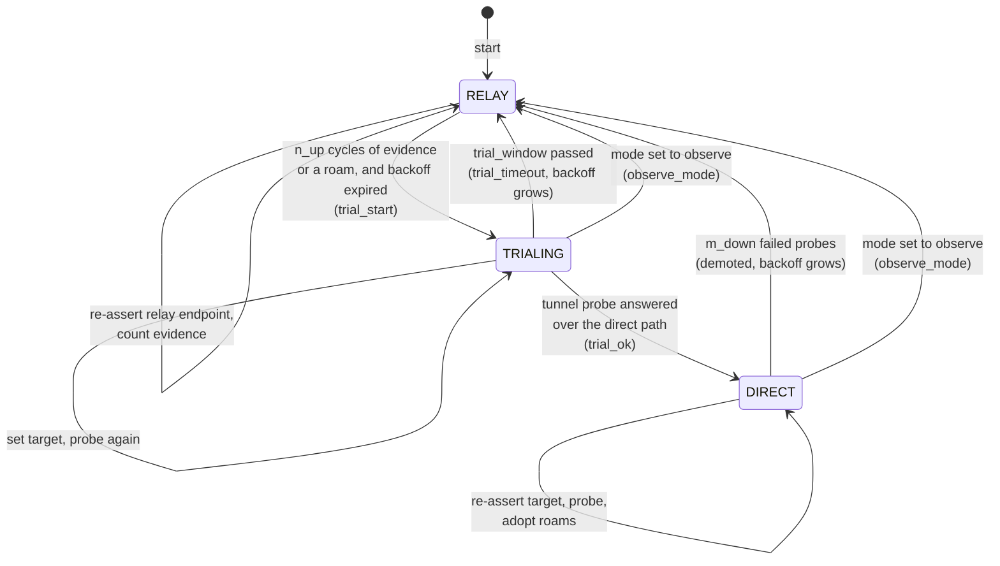
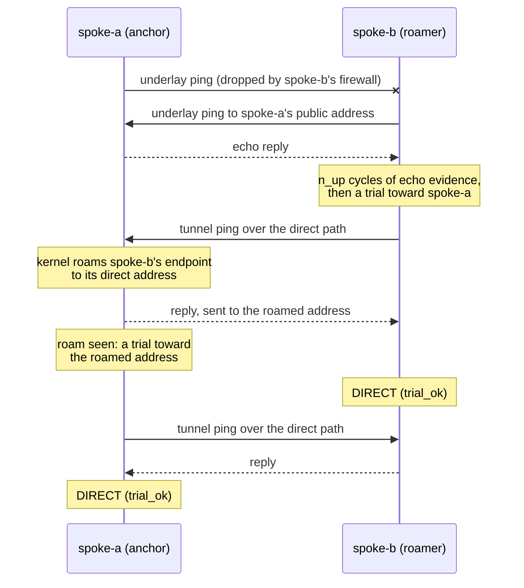

# About the Path State Machine

On a spoke, every managed mesh peer has its own small state machine. It has three states: **RELAY**, **TRIALING** and **DIRECT**. This page explains why it has those states, what moves a peer between them, and why the rules are lopsided on purpose.

---

## The shape

Every peer starts in RELAY, including after a restart. State is kept in memory only, so a restarted daemon earns direct again from scratch. That takes a few seconds and keeps the design simple. A configuration reload is gentler: it keeps the state of every peer whose annotations did not change (see [Architecture](architecture.md#reload)).

Once per cycle (every 3 seconds by default), wgpathd sets the endpoint the current state calls for: the relay endpoint in RELAY, the direct target in TRIALING and DIRECT. It does this every cycle even if nothing changed. `wg set ... endpoint` does not rekey or interrupt the session, so re-asserting is harmless.

## Evidence first, then proof

A direct path needs two different kinds of support before wgpathd commits to it.

**Evidence** is cheap and gathered every cycle. There are two kinds:

- **Underlay echo.** wgpathd pings the peer's public IPv6 address (the candidate learned from [discovery](discovery.md)) outside the tunnel. A reply means the peer's host is reachable on IPv6.
- **Authenticated roam.** WireGuard moves a peer's endpoint to the source address of the last valid packet from that peer. If the kernel shows an endpoint that is neither what wgpathd set nor the relay, the peer has just reached us directly, and it did so with a packet that passed its static key. Nobody can fake that without the key.

A peer needs `n_up` consecutive cycles of evidence (5 by default, about 15 seconds) before a trial may start. A roam is the exception: one is enough, for reasons explained [below](#why-the-anchor-needs-roams).

Evidence is not proof. A host can answer ICMP while its firewall drops UDP to the WireGuard port. So the next step is a **trial**: wgpathd sets the endpoint to the direct target and immediately sends a ping to the peer's tunnel address, through `wg_mesh`. Only an answer to that ping, coming back over the direct path, commits the peer to DIRECT. It proves the whole path works, in both directions, for real WireGuard traffic.

Why a round trip, and not "wait for a new handshake"? Because changing an endpoint does not start a handshake. The session keys stay the same, and the kernel only rekeys every two minutes or after sends go unanswered. A trial that waited for a handshake would fail on good paths and bad paths alike. So wgpathd never uses handshake age to decide anything; it is shown in the hub's discovery data for diagnosis only.

In DIRECT, the same tunnel ping runs every cycle. It is the health check, and it also keeps the session and any stateful firewall on the path warm.

## Relay traffic and the proof

WireGuard roams on every authenticated packet, and that includes packets that come through the relay. Suppose spoke-b trials while spoke-a is still in RELAY and its site is sending traffic. wgpathd on spoke-b sets the direct endpoint, and a moment later a packet from spoke-a arrives through the hub and moves spoke-b's endpoint straight back to the relay. The trial ping then leaves through the relay, spoke-a answers it through the relay, and the answer says nothing about the direct path. Counting it would commit DIRECT on a path that may be dead, and on a dead path the daemon would then re-assert the dead endpoint every cycle and never back off.

So an answer only counts if it came back direct. The answer is itself an authenticated packet: it moves the kernel endpoint to wherever it came from. wgpathd reads the endpoint right after the answer arrives, and if that is the relay endpoint, the answer does not count:

- in TRIALING the trial carries on, setting the target and probing again each cycle, and times out with a backoff if no answer comes back direct before the deadline;
- in DIRECT it counts as a failed probe toward `m_down`.

The endpoint is read right after the answer, not at the start of the next cycle, on purpose. A peer in RELAY re-asserts its relay endpoint every cycle. If it has traffic to send, its next packet comes through the relay and moves our endpoint back there, well before our next cycle begins. A check made then would reject every answer while the other side is in RELAY, even on a healthy path, and two sides whose backoffs run out at different times could each wait for the other forever.

A trial is still at the mercy of timing under heavy traffic from the other side: if a relayed packet lands between `wg set` and the ping, the ping itself goes through the relay. The trial then simply tries again on its next cycle.

## What a trial costs

A trial is not free. A WireGuard peer has one endpoint, so while a trial runs, all traffic to that peer takes the candidate path. On a good path the probe answers on the next cycle and nothing is lost. On a bad one, that peer's traffic is lost until the trial window ends, up to `trial_window` (8 seconds by default), and then it returns to the relay.

There is no cheaper test. WireGuard ignores unauthenticated packets, so nothing outside the tunnel can prove a path works, and one peer cannot use two endpoints at once.

The cost repeats when the evidence is misleading: a peer that answers ICMPv6 echo while a firewall blocks UDP to its WireGuard port. The echo keeps producing evidence, so each backoff expiry starts another trial and loses another window. The backoff grows to 15 minutes, which bounds the loss to one trial window per backoff interval, about 1% of that peer's traffic once the backoff reaches its cap.

## Why the anchor needs roams

Picture the common case. spoke-a is the **anchor**: it accepts inbound IPv6. spoke-b is a **roamer** behind a stateful firewall that drops unsolicited traffic.

- spoke-b pings spoke-a's public address. spoke-a answers. spoke-b has evidence, trials, and goes DIRECT.
- spoke-a pings spoke-b's public address. spoke-b's firewall drops it. spoke-a never gets echo evidence.

If echo were the only evidence, spoke-a would stay on the relay forever. It does not, because spoke-b's trial and health pings arrive at spoke-a directly. Each one roams spoke-a's kernel endpoint to spoke-b's direct address. spoke-a reads that roam as evidence and trials toward the roamed address at once, without waiting for `n_up` cycles, and goes DIRECT too.

One roam is enough because it is authenticated proof that spoke-b is sending to spoke-a directly right now, and because waiting would defeat spoke-b. Until spoke-a trials, it re-asserts the relay every cycle, and its site's traffic then reaches spoke-b through the relay and pulls spoke-b's endpoint back onto it. Under steady traffic, spoke-b's pings reach spoke-a directly only now and then. A streak of `n_up` roams could take far longer than spoke-b's trial window. The trial still has to pass, and the backoff still applies.

This is also why wgpathd reads roams before it re-asserts. A daemon that blindly overwrote the endpoint every cycle would fight WireGuard's per-packet roaming instead of learning from it.

In DIRECT, a roam to a new direct address is adopted as the new target, logged as a `roam` event. This is how a spoke follows a peer that changes address while direct is healthy, with no dip to the relay. A roam to the relay address is not adopted: it only means the other side is relaying for now. If the probe's answer came back through the relay as well, it counts as a failed probe (see [Relay traffic and the proof](#relay-traffic-and-the-proof)).

## Fast down, slow up

The rules are asymmetric on purpose.

- **Falling back is fast.** In DIRECT, `m_down` failed tunnel probes in a row (2 by default) demote the peer to RELAY. Each probe's answer is read on the next cycle, and on a dead path every cycle also waits for its probes to time out, so with the defaults a dead path is left in roughly 8 to 15 seconds. A probe that did not complete in time counts as failed, and so does one answered through the relay. The relay is the safe place to be when in doubt.
- **Coming back is slow.** A return to direct needs `n_up` cycles of evidence (or a roam from a peer that is already trialing or DIRECT) **and** a successful trial, **and** the backoff must have expired.

The backoff is what stops a flapping path from bouncing. Each failed trial and each demotion bumps it: the first time to `backoff_min` (30 seconds), then doubling each time up to `backoff_max` (15 minutes). It resets only after DIRECT has held for `backoff_reset` (10 minutes). A path that works for a minute and then breaks walks its backoff up to the cap and ends up parked on the relay, which is the outcome you want from a bad path. Evidence keeps counting during the backoff, so a peer that is ready trials as soon as the backoff ends.

A quiet link is never demoted for being quiet. DIRECT is judged only by the tunnel probe, which wgpathd sends itself, never by traffic or handshake age.

## Observe and steer

A spoke runs in one of two modes.

In **steer** mode the state machine runs as described.

In **observe** mode a peer never leaves RELAY and no tunnel probes are sent. Evidence is still gathered and counted, and the status reports `ready: true`, and the log `ready, steer would trial`, when a peer has enough evidence that steer mode would start a trial. This lets you watch what wgpathd would do on a live network before you let it move traffic. Observe is the default, and any unknown mode value is treated as observe.

Observe mode is not hands-off. A managed peer is still set to its relay endpoint every cycle. The whole point of observe is that every managed peer sits on the known-good floor while you watch. Switching a DIRECT peer back to observe demotes it to RELAY, without a backoff, with the reason `observe_mode`.

## Further reading

- [Timing parameters](../reference/parameters.md) lists every knob and its default.
- [ubus status](../reference/ubus-status.md) shows where each of these values appears at runtime.
- The [design record](../design.md) has the full transition table, the decide rules for edge cases and the failure-mode catalog that motivated each rule.
