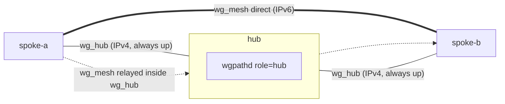

# wgpathd

wgpathd is a small ucode daemon for OpenWrt that keeps each WireGuard mesh peer on its best working path. Between two spokes it prefers a **direct** IPv6 path, and it falls back to a **relay** through the hub when the direct path does not work. It does this by rewriting one thing only: the endpoint of each mesh peer, with `wg set <iface> peer <key> endpoint <addr>`. The hub also runs wgpathd, in a second role: it publishes the IPv6 endpoints it sees, so that spokes know where to look for each other.

## Who it is for

wgpathd is for operators who already run WireGuard hub-and-spoke on OpenWrt and want site-to-site traffic to skip the hub whenever it can. It does not build your tunnels. You bring the WireGuard setup; wgpathd steers it.

Before wgpathd can do anything useful you need:

- **Two WireGuard interfaces on every node, with separate keys.** `wg_hub` is the IPv4 tunnel from each spoke to the hub. It is always up and it carries the relay. `wg_mesh` is the IPv6 mesh whose peer endpoints wgpathd steers.
- **Endpoint-less mesh peers with annotations.** On each spoke, every other spoke is a `wg_mesh` peer with no `endpoint`, plus two extra UCI options: `wgpathd_relay` (where to send when relaying) and `wgpathd_tunnel` (the peer's address inside the tunnel, used for the health probe).
- **A hub that forwards the transit range.** The hub forwards traffic between its `wg_hub` peers, so a spoke can reach another spoke's `wg_hub` address through it.
- **At least one inbound-reachable IPv6 site.** A pair of spokes goes direct if at least one of them accepts inbound WireGuard over IPv6. If neither does, that pair stays on the relay.

[How to prepare the WireGuard substrate](how-to/prepare-substrate.md) walks through all of this.

## Documentation map

### [Tutorials](tutorials/index.md)
**Learning-oriented.** A guided first session with the development environment: run the tests, build the package, check it installs.

### [How-to guides](how-to/index.md)
**Goal-oriented.** Prepare the substrate, install, configure the hub and the spokes, turn on steering, apply changes, tune timing, troubleshoot, remove. Plus developer tasks.

### [Reference](reference/index.md)
**Information-oriented.** Every UCI option, parameter, service command, status field, HTTP behavior, log message, error code, installed file and firewall rule.

### [Explanation](explanation/index.md)
**Understanding-oriented.** Why direct-versus-relay works the way it does: the state machine, discovery, the trust model and the architecture.

### Project records
The [design record](design.md) is the internal design contract, with the full rationale and failure-mode catalog. The [substrate build history](history.md) is the dated log of how the original WireGuard substrate was built. Both are kept as written.
