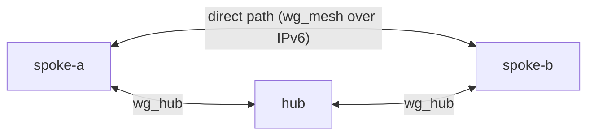

# Your First Failover

In this tutorial we will set up wgpathd on a hub and two spokes, watch both spokes move their traffic onto the direct path, cut that path while a ping runs, and watch the relay through the hub take over without the ping dying. Then we will put the direct path back and watch wgpathd return to it.

Everything happens in a lab: three OpenWrt containers on one Docker network, with the WireGuard interfaces and the firewall already set up the way [How to prepare the WireGuard substrate](../how-to/prepare-substrate.md) and [How to open the firewall for wgpathd](../how-to/open-firewall.md) describe. wgpathd is installed on all three but switched off. Turning it on is our job.



The spokes talk to each other directly. When that path breaks, their traffic goes spoke → hub → spoke instead: the relay.

---

## Prerequisites

- A Linux machine with systemd's journal, whose kernel has the WireGuard module (`modinfo wireguard` prints its details). The containers share our kernel, so the module must be the host's.
- Docker, with permission to run containers as our user, and permission to give them the `NET_ADMIN` and `NET_RAW` capabilities. Nothing runs privileged.
- `make`.
- A copy of the wgpathd repository.
- About 6 GB of free disk space for the images, most of it for the OpenWrt SDK that builds the package, and a network connection for the first run.

While the lab runs, it guards our machine's network. It lists any containers of other projects that are running, as a warning, and a watchdog checks our network interface and the kernel log every two seconds and tears the lab down if the interface goes away. It watches `wlan0` unless we name another interface, for example with `export E2E_WATCH_IFACE=eth0`. The guard exists because the lab gives kernel WireGuard and network privileges to containers on the machine we work on; running the lab inside a virtual machine is the cautious choice.

The lab uses wgpathd's default timing, so everything we wait for here takes as long as it would on a router. The exact seconds vary a little from run to run.

## Step 1: Start the lab

In a terminal, in the root of the repository:

```bash
make lab-up
```

The first time, this builds the package and the lab image, which takes several minutes. Later runs take about half a minute. The output ends like this:

```
lab: building the package and the image
lab: starting hub, spoke-a and spoke-b
lab: up, wgpathd installed and disabled on hub, spoke-a and spoke-b
lab: open a node with 'make lab-shell NODE=<node>', stop with 'make lab-down'
```

We keep this terminal for `make` commands. From now on we call it the host terminal.

## Step 2: Look around the hub

We open a second terminal and log in to the hub:

```bash
make lab-shell NODE=hub
```

We see the OpenWrt banner and the prompt `root@hub:/#`. Everything we type here runs on the hub. Let's look at its mesh interface:

```bash
wg show wg_mesh
```

```
interface: wg_mesh
  public key: u8maAxX3TJoR2m/cKuXIdWp9UrsA5JI0AIzUG7rqDgU=
  private key: (hidden)
  listening port: 51820

peer: uPLXea2jUXzX+M8u+y7heE1IMxUHIpfBW9/ne7ed3Rk=
  endpoint: [fd77:e2e0:0:1::12]:51820
  allowed ips: 10.20.0.12/32
  latest handshake: Now
  transfer: 180 B received, 92 B sent

peer: LYDoEcV/YLkxr9GYfrK09QlYM+hg26XXorS9TlEZ/2o=
  endpoint: [fd77:e2e0:0:1::11]:51820
  allowed ips: 10.20.0.11/32
  latest handshake: Now
  transfer: 180 B received, 92 B sent
```

The keys are generated fresh for every lab, so ours differ. What matters is that the hub sees both spokes, and it sees them at their IPv6 addresses: `...::11` is spoke-a and `...::12` is spoke-b. The hub will tell each spoke where the other one is.

Now let's ask wgpathd how it is doing:

```bash
service wgpathd status
```

```
active with no instances
disabled (option enabled in /etc/config/wgpathd)
```

Installed, but not running. This is how the package arrives on a router.

## Step 3: Configure the hub

We replace the hub's configuration. The hub reads `wg_mesh` and publishes what it sees on its own `wg_hub` address, `10.10.0.1`:

```bash
cat > /etc/config/wgpathd <<'EOF'
config wgpathd 'main'
	option enabled    '1'
	option role       'hub'
	option read_iface 'wg_mesh'
	option serve_addr '10.10.0.1'
	option serve_port '7780'
EOF
```

Before starting anything, we let wgpathd check the configuration and the interfaces:

```bash
service wgpathd check
```

```
ok    config: hub, reads wg_mesh, serves 10.10.0.1:7780
ok    wg_mesh: up, 2 peers
ok    firewall: TCP port 7780 (peer list) from wg_hub (zone vpn): accepted
```

Three `ok` lines: the configuration, the mesh interface, and the firewall rule that lets the spokes fetch the peer list. Let's start it and look again:

```bash
service wgpathd start
service wgpathd status
```

```
running
role: hub
published peers:
  LYDoEcV/  [fd77:e2e0:0:1::11]:51820  handshake 1s ago
  uPLXea2j  [fd77:e2e0:0:1::12]:51820  handshake 1s ago
```

The hub now publishes both spokes' direct addresses. Its work is done; we type `exit` to leave the hub.

## Step 4: Configure spoke-a in observe mode

We log in to spoke-a, in a terminal we will keep open until the end:

```bash
make lab-shell NODE=spoke-a
```

The prompt is now `root@spoke-a:/#`. First, let's see how spoke-a knows its peer spoke-b:

```bash
uci show network.spoke_b
```

```
network.spoke_b=wireguard_wg_mesh
network.spoke_b.public_key='uPLXea2jUXzX+M8u+y7heE1IMxUHIpfBW9/ne7ed3Rk='
network.spoke_b.allowed_ips='10.12.0.0/16' '10.20.0.12/32'
network.spoke_b.route_allowed_ips='1'
```

An ordinary WireGuard peer: a key, the addresses it may use, and no endpoint. wgpathd will set the endpoint. To steer spoke-b, it needs two more things about it: how to reach spoke-b through the hub, its relay endpoint `10.10.0.12:51820`, and spoke-b's address inside the mesh, its tunnel address `10.20.0.12`, which wgpathd pings to prove a path works.

These go into wgpathd's own configuration, in a `peer` section that names spoke-b by its public key. We start in observe mode, where wgpathd only watches and reports. The heredoc is not quoted, so the shell fills in spoke-b's key from the network configuration:

```bash
cat > /etc/config/wgpathd <<EOF
config wgpathd 'main'
	option enabled    '1'
	option role       'spoke'
	option mesh_iface 'wg_mesh'
	option hub_iface  'wg_hub'
	option discovery  'http://10.10.0.1:7780/peers'
	option mode       'observe'

config peer
	option public_key '$(uci get network.spoke_b.public_key)'
	option relay      '10.10.0.12:51820'
	option tunnel     '10.20.0.12'
EOF
service wgpathd check
```

```
ok    config: spoke, mode observe, 1 steered peer, 1 not steered
ok    wg_mesh: up, 2 peers
ok    wg_hub: up, 1 peer
ok    peer spoke_b: relay 10.10.0.12:51820 via wg_hub, probes 10.20.0.12
skip  peer hub: not steered (not configured)
ok    firewall: ICMP echo-request (tunnel probe) from wg_mesh (zone vpn): accepted
ok    firewall: UDP port 51820 (relayed WireGuard) from wg_hub (zone vpn): accepted
ok    firewall: ICMPv6 echo-request (underlay probe) from zone wan: accepted
```

spoke-b will be steered; the hub is left alone, since it has no `peer` section ([Peer sections](../reference/uci-config.md#peer-sections) lists the options). The last three lines say that spoke-a's firewall lets in what spoke-b will send it: its pings to spoke-a's mesh address, its packets through the hub, and its pings to spoke-a's public address. Let's start it:

```bash
service wgpathd start
service wgpathd status
```

```
running
role: spoke (mode observe)
discovery: fresh (last success 3s ago)
peers:
  spoke_b  uPLXea2j  RELAY  10.10.0.12:51820  no change yet  0 switches
unmanaged:
  hub  u8maAxX3  not configured
```

spoke-b is in `RELAY`, with its relay address as the endpoint. `discovery: fresh` means spoke-a has fetched the hub's list.

## Step 5: Configure spoke-b the same way

In another terminal, we log in to spoke-b:

```bash
make lab-shell NODE=spoke-b
```

spoke-b gets the same `main` section, and a `peer` section for spoke-a, with spoke-a's key, relay endpoint and tunnel address:

```bash
cat > /etc/config/wgpathd <<EOF
config wgpathd 'main'
	option enabled    '1'
	option role       'spoke'
	option mesh_iface 'wg_mesh'
	option hub_iface  'wg_hub'
	option discovery  'http://10.10.0.1:7780/peers'
	option mode       'observe'

config peer
	option public_key '$(uci get network.spoke_a.public_key)'
	option relay      '10.10.0.11:51820'
	option tunnel     '10.20.0.11'
EOF
service wgpathd check
service wgpathd start
service wgpathd status
```

The check lists `peer spoke_a` this time, and the status ends like this:

```
peers:
  spoke_a  LYDoEcV/  RELAY  10.10.0.11:51820  no change yet  0 switches
unmanaged:
  hub  u8maAxX3  not configured
```

Both spokes now hold each other on the relay.

## Step 6: Watch the peers become ready

Back on spoke-a, let's ping spoke-b's mesh address:

```bash
ping -c 3 10.20.0.12
```

```
PING 10.20.0.12 (10.20.0.12): 56 data bytes
64 bytes from 10.20.0.12: seq=0 ttl=64 time=1.983 ms
64 bytes from 10.20.0.12: seq=1 ttl=64 time=2.066 ms
64 bytes from 10.20.0.12: seq=2 ttl=64 time=1.849 ms

--- 10.20.0.12 ping statistics ---
3 packets transmitted, 3 packets received, 0% packet loss
round-trip min/avg/max = 1.849/1.966/2.066 ms
```

These replies travel through the hub. The relay works, which is the floor wgpathd always falls back to.

Meanwhile wgpathd has been collecting evidence that the direct path would work too. Let's read its log:

```bash
logread -e wgpathd
```

About 15 seconds after the start, a line like the last one here appears:

```
Sun Sep 27 16:00:07 2026 daemon.warn procd: failed adding instance cgroup for wgpathd: Operation not permitted
Sun Sep 27 16:00:07 2026 daemon.warn wgpathd[1329]: peer hub (u8maAxX3): unmanaged reason=not configured
Sun Sep 27 16:00:07 2026 daemon.info wgpathd[1329]: discovery cache: none usable
Sun Sep 27 16:00:07 2026 daemon.notice wgpathd[1329]: started role=spoke mode=observe managed=1 unmanaged=1
Sun Sep 27 16:00:22 2026 daemon.notice wgpathd[1329]: peer spoke_b (uPLXea2j): ready, steer would trial endpoint=[fd77:e2e0:0:1::12]:51820
```

The first line is procd noting that it cannot create a cgroup inside a container; we can ignore it. If the `ready` line is not there yet, we wait a few seconds and run the command again.

`ready, steer would trial` is observe mode telling us what it would do. The same shows in the full status, as `"ready": true`:

```bash
ubus call wgpathd status
```

```
{
	"role": "spoke",
	"mode": "observe",
	"now": 1790524823,
	"mesh_iface": "wg_mesh",
	"hub_iface": "wg_hub",
	"params": {
		"cycle": 3,
		"n_up": 5,
		"m_down": 2,
		"tunnel_timeout": 1,
		"trial_window": 8,
		"backoff_min": 30,
		"backoff_max": 900,
		"backoff_reset": 600,
		"discovery_interval": 60,
		"give_up_after": 3,
		"give_up_pause": 21600
	},
	"discovery": {
		"fresh": true,
		"last_ok": 1790524807,
		"url": "http://10.10.0.1:7780/peers"
	},
	"peers": {
		"uPLXea2jUXzX+M8u+y7heE1IMxUHIpfBW9/ne7ed3Rk=": {
			"state": "RELAY",
			"up_streak": 5,
			"down_streak": 0,
			"backoff": 0,
			"ready": true,
			"section": "spoke_b",
			"endpoint": "10.10.0.12:51820",
			"target": null,
			"candidate": "[fd77:e2e0:0:1::12]:51820",
			"last_target": null,
			"since": 1790524807,
			"trial_deadline": null,
			"next_trial": null,
			"failed_target": null,
			"failed_trials": 0,
			"given_up": null,
			"switches": 0,
			"relayed_answers": 0,
			"last_change": null
		}
	},
	"unmanaged": [
		{
			"section": "hub",
			"pubkey": "u8maAxX3TJoR2m/cKuXIdWp9UrsA5JI0AIzUG7rqDgU=",
			"reason": "not configured"
		}
	],
	"history": []
}
```

`up_streak` counts the cycles of evidence; five in a row make a peer ready. Each field is described in [ubus status](../reference/ubus-status.md).

## Step 7: Switch both spokes to steer

Now we let wgpathd act. On spoke-b, and then on spoke-a, we run:

```bash
uci set wgpathd.main.mode='steer'
uci commit wgpathd
service wgpathd reload
```

On spoke-a, we follow the log:

```bash
logread -f -e wgpathd
```

Within a few seconds, three new lines appear:

```
Sun Sep 27 16:00:23 2026 daemon.notice wgpathd[1329]: configuration reloaded peers_kept=1 added=0 removed=0 mode=steer
Sun Sep 27 16:00:25 2026 daemon.notice wgpathd[1329]: peer spoke_b (uPLXea2j): transition RELAY -> TRIALING reason=trial_start endpoint=[fd77:e2e0:0:1::12]:51820
Sun Sep 27 16:00:28 2026 daemon.notice wgpathd[1329]: peer spoke_b (uPLXea2j): transition TRIALING -> DIRECT reason=trial_ok endpoint=[fd77:e2e0:0:1::12]:51820
```

wgpathd tried the direct path (`TRIALING`), a ping through it came back, and it committed (`DIRECT`). We press Ctrl-C to stop following, and look at the status:

```bash
service wgpathd status
```

```
running
role: spoke (mode steer)
discovery: fresh (last success 23s ago)
peers:
  spoke_b  uPLXea2j  DIRECT  [fd77:e2e0:0:1::12]:51820  3s ago (trial_ok)  2 switches
unmanaged:
  hub  u8maAxX3  not configured
```

Let's confirm it with WireGuard itself:

```bash
wg show wg_mesh endpoints
```

```
u8maAxX3TJoR2m/cKuXIdWp9UrsA5JI0AIzUG7rqDgU=	[fd77:e2e0:0:1::10]:51820
uPLXea2jUXzX+M8u+y7heE1IMxUHIpfBW9/ne7ed3Rk=	[fd77:e2e0:0:1::12]:51820
```

The kernel now sends spoke-b's traffic straight to spoke-b's IPv6 address. Running `service wgpathd status` on spoke-b shows the same from the other side:

```
  spoke_a  LYDoEcV/  DIRECT  [fd77:e2e0:0:1::11]:51820  2s ago (trial_ok)  2 switches
```

Both spokes are direct. The path between them no longer goes through the hub.

## Step 8: Kill the direct path

On spoke-a, we start a ping that keeps running:

```bash
ping 10.20.0.12
```

While the replies scroll, we switch to the host terminal and cut the direct path between the spokes. The hub and the relay stay up:

```bash
make lab-fault NAME=kill-direct
```

```
lab: direct path between the spokes cut
```

Back on spoke-a, the replies stop. After about ten seconds they come back. Once a few more have arrived, we press Ctrl-C:

```
PING 10.20.0.12 (10.20.0.12): 56 data bytes
64 bytes from 10.20.0.12: seq=0 ttl=64 time=0.488 ms
64 bytes from 10.20.0.12: seq=1 ttl=64 time=0.954 ms
64 bytes from 10.20.0.12: seq=2 ttl=64 time=0.791 ms
64 bytes from 10.20.0.12: seq=3 ttl=64 time=0.835 ms
64 bytes from 10.20.0.12: seq=4 ttl=64 time=0.687 ms
64 bytes from 10.20.0.12: seq=15 ttl=64 time=1.733 ms
64 bytes from 10.20.0.12: seq=16 ttl=64 time=2.128 ms
64 bytes from 10.20.0.12: seq=17 ttl=64 time=1.979 ms
64 bytes from 10.20.0.12: seq=18 ttl=64 time=2.069 ms
64 bytes from 10.20.0.12: seq=19 ttl=64 time=2.506 ms
64 bytes from 10.20.0.12: seq=20 ttl=64 time=2.155 ms
64 bytes from 10.20.0.12: seq=21 ttl=64 time=1.764 ms
64 bytes from 10.20.0.12: seq=22 ttl=64 time=1.945 ms
64 bytes from 10.20.0.12: seq=23 ttl=64 time=1.626 ms

--- 10.20.0.12 ping statistics ---
24 packets transmitted, 14 packets received, 41% packet loss
round-trip min/avg/max = 0.488/1.547/2.506 ms
```

Notice the jump from `seq=4` to `seq=15`: ten replies lost while wgpathd made sure the direct path was really dead, then the ping carries on. Notice too that the times after the gap are about twice as long. The replies now take the longer way, through the hub. Our loss count depends on how long we let the ping run; the gap itself is the part to look at.

Let's see what wgpathd did:

```bash
service wgpathd status
```

```
running
role: spoke (mode steer)
discovery: fresh (last success 48s ago)
peers:
  spoke_b  uPLXea2j  RELAY  10.10.0.12:51820  10s ago (demoted)  3 switches
unmanaged:
  hub  u8maAxX3  not configured
```

```bash
logread -e wgpathd | tail -n 1
```

```
Sun Sep 27 16:00:45 2026 daemon.notice wgpathd[1329]: peer spoke_b (uPLXea2j): transition DIRECT -> RELAY reason=demoted failed_probes=2 backoff=30s endpoint=10.10.0.12:51820
```

Two health pings through the direct path failed (`failed_probes=2`), so wgpathd moved spoke-b back to the relay. It will not try the direct path again for 30 seconds (`backoff=30s`). WireGuard agrees:

```bash
wg show wg_mesh endpoints
```

```
u8maAxX3TJoR2m/cKuXIdWp9UrsA5JI0AIzUG7rqDgU=	[fd77:e2e0:0:1::10]:51820
uPLXea2jUXzX+M8u+y7heE1IMxUHIpfBW9/ne7ed3Rk=	10.10.0.12:51820
```

spoke-b's endpoint is its relay address again. spoke-b did the same towards spoke-a.

If we take longer than half a minute here, the log shows two more lines, `RELAY -> TRIALING` and then `TRIALING -> RELAY reason=trial_timeout backoff=60s`: once the backoff ran out, wgpathd tried the direct path, found it still dead, and doubled the backoff. That is expected, and it only makes the next step take longer. [About the path state machine](../explanation/state-machine.md#fast-down-slow-up) explains why wgpathd falls back fast and comes back slowly.

If we take longer than about four minutes, a third failed test in a row makes wgpathd give the address up: the log says `direct address given up`, and wgpathd would not test the address again for six hours. In that case, once the next step has restored the path, we run `service wgpathd restart` on both spokes, and they earn the direct path again from scratch. [Giving up an address](../explanation/state-machine.md#giving-up-an-address) explains why.

## Step 9: Restore the direct path

In the host terminal:

```bash
make lab-fault NAME=restore
```

```
lab: faults cleared
```

On spoke-a, we follow the log again:

```bash
logread -f -e wgpathd
```

When the backoff has run out, which is within a minute, the trial runs again and this time succeeds:

```
Sun Sep 27 16:01:15 2026 daemon.notice wgpathd[1329]: peer spoke_b (uPLXea2j): transition RELAY -> TRIALING reason=trial_start endpoint=[fd77:e2e0:0:1::12]:51820
Sun Sep 27 16:01:18 2026 daemon.notice wgpathd[1329]: peer spoke_b (uPLXea2j): transition TRIALING -> DIRECT reason=trial_ok endpoint=[fd77:e2e0:0:1::12]:51820
```

We press Ctrl-C and check:

```bash
service wgpathd status
```

```
running
role: spoke (mode steer)
discovery: fresh (last success 11s ago)
peers:
  spoke_b  uPLXea2j  DIRECT  [fd77:e2e0:0:1::12]:51820  2s ago (trial_ok)  5 switches
unmanaged:
  hub  u8maAxX3  not configured
```

Direct again, with 5 switches counted. spoke-b's status shows `DIRECT` as well.

## Step 10: Tear the lab down

We type `exit` in the spoke-a and spoke-b shells, and in the host terminal run:

```bash
make lab-down
```

```
lab: tearing down
--- host
unchanged: net.ipv6.conf.all.forwarding = 0
unchanged: net.ipv6.conf.wlan2.accept_ra = 0
wlan2: up
ip monitor: 630 lines, kernel log: 139 lines (in .../wgpathd/bin/lab)
```

Our interface name shows in place of `wlan2`, and the full path of our copy of the repository in place of `...`. The containers are gone, and the guard reports that our machine's network settings are as they were before the lab started. The next `make lab-up` starts again from a clean lab, so we can repeat any of these steps.

## What we did

We configured the hub to publish the spokes' direct addresses, started both spokes in observe mode and watched them collect evidence until they were ready, and switched them to steer, where each one proved the direct path with a trial and moved onto it. Then we cut the direct path under a running ping and saw wgpathd fall back to the relay within about ten seconds while the ping carried on through the hub, and saw it return to the direct path once the path was back and the backoff had run out.

## Where to go next

- [About wgpathd](../explanation/about.md) explains direct and relay paths and why a hub-and-spoke network wants both.
- [About the path state machine](../explanation/state-machine.md) explains evidence, trials, demotion and backoff, which we just watched.
- [How to prepare the WireGuard substrate](../how-to/prepare-substrate.md) is where a real deployment starts, followed by [configuring the hub](../how-to/configure-hub.md), [configuring a spoke](../how-to/configure-spoke.md) and [moving a spoke from observe to steer](../how-to/enable-steering.md).
- [Log messages](../reference/log-messages.md) lists every line we saw in the log.
- [Make targets](../reference/make-targets.md) lists the lab's targets.
